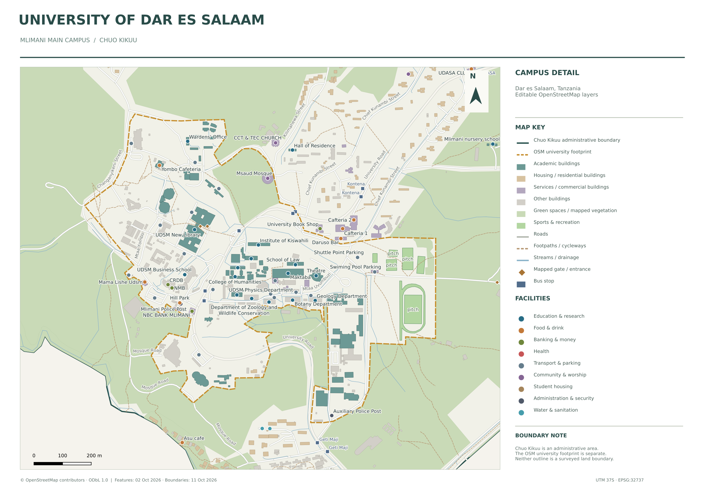
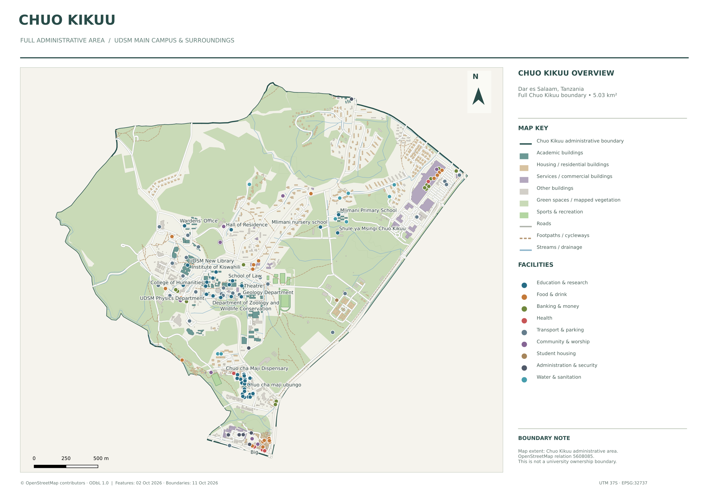
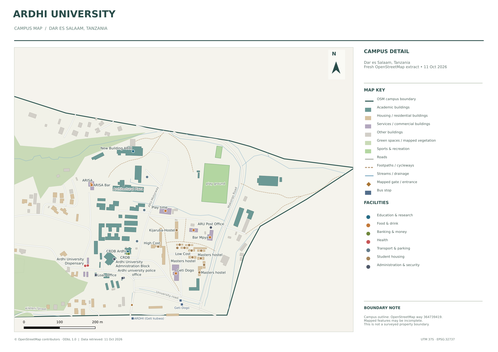
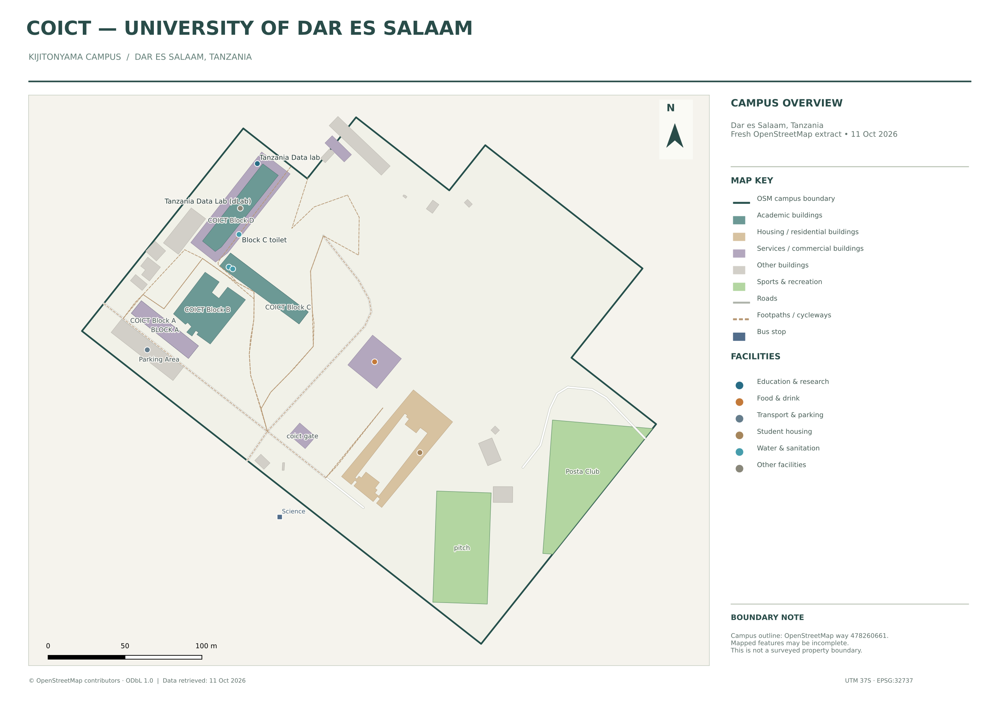

# University Campuses — QGIS Projects

Editable OpenStreetMap-based campus maps for **University of Dar es Salaam (UDSM)**, **Ardhi University**, and **UDSM CoICT Kijitonyama** in Dar es Salaam, Tanzania.

Each ZIP is a complete QGIS package containing projects, editable geographic data, reusable styles, instructions and map previews. Packaged vector layers work offline. The optional OpenStreetMap tile basemap needs internet.

## Download a campus project

| Campus / map | Download | Project to open after extracting |
| --- | --- | --- |
| UDSM Mlimani main campus and Chuo Kikuu overview | [UDSM_Main_Campus_QGIS.zip](https://github.com/Heed725/University-Campuses-QGIS-Project/raw/refs/heads/main/downloads/UDSM_Main_Campus_QGIS.zip) | `UDSM_Main_Campus.qgz` or `UDSM_Campus_Detail.qgz` |
| Full Chuo Kikuu administrative area — additional UDSM-area version | [Chuo_Kikuu_QGIS.zip](https://github.com/Heed725/University-Campuses-QGIS-Project/raw/refs/heads/main/downloads/Chuo_Kikuu_QGIS.zip) | `Chuo_Kikuu.qgz` |
| Ardhi University | [Ardhi_University_QGIS.zip](https://github.com/Heed725/University-Campuses-QGIS-Project/raw/refs/heads/main/downloads/Ardhi_University_QGIS.zip) | `Ardhi_University.qgz` or `Ardhi_Campus_Detail.qgz` |
| CoICT Kijitonyama campus | [CoICT_QGIS.zip](https://github.com/Heed725/University-Campuses-QGIS-Project/raw/refs/heads/main/downloads/CoICT_QGIS.zip) | `CoICT_Kijitonyama.qgz` |

## Open in QGIS

1. Download the ZIP for your campus.
2. **Extract the ZIP first.** Do not open a project inside the archive.
3. Open the project listed above in **QGIS 3.34 or newer**, including QGIS 3.40.
4. Keep the `data` folder beside the project files. Move the extracted folder together if changing computers.
5. Read the package's `README.md` for layer editing, searches and map exports.

No additional QGIS plugin is required. Open **Project → Layouts** to export the included map sheets as PDF or PNG. The layouts include a legend, scale bar, north arrow and attribution.

## UDSM — Mlimani main campus

Buildings, roads, paths, facilities, vegetation, sports areas, drainage and mapped access/transport features. The separate OSM university footprint is distinguished from the wider Chuo Kikuu administrative boundary.

### Full Chuo Kikuu area

The dedicated Chuo Kikuu version opens on the full administrative area, with the university footprint optional and initially hidden. Nearby facilities are included according to geography; UDSM affiliation or ownership is not inferred.

## Ardhi University

Full campus overview and a closer teaching/hostel view, with named departments and mapped services where available.

## CoICT — Kijitonyama

The CoICT Kijitonyama campus, with mapped blocks, Tanzania Data Lab, roads, paths, facilities and sports areas.

## Data and project details

- Editable GeoPackage layers use **EPSG:32737 — WGS 84 / UTM zone 37S**.
- GeoJSON copies use **EPSG:4326 — WGS 84**.
- Relative project paths keep packages portable.
- OSM names and tags are preserved. Some records are unnamed, duplicated or overlapping.
- Every package includes a facilities CSV and validation notes.
- Projects were rendered and reopened with QGIS **3.34.4**; copied-folder checks verified packaged layer and layout links and geometry validity.
- [SHA256SUMS.txt](SHA256SUMS.txt) provides download checksums.

### Source dates

UDSM/Chuo Kikuu features use the **2 October 2026** OSM snapshot preserved in [UDSM Campus Explorer](https://github.com/Heed725/UDSM_Campus_Explorer). Their boundary features were retrieved **11 October 2026**. Ardhi and CoICT campus data and boundaries were downloaded **11 October 2026**.

### Boundaries and attribution

Campus outlines are OpenStreetMap features, **not surveyed property boundaries**. Chuo Kikuu is an administrative subward, not the university estate. Counts describe mapped OSM records, not official asset registers.

Geographic data **© OpenStreetMap contributors**, licensed under **ODbL 1.0**. See [NOTICE.md](NOTICE.md), [OpenStreetMap copyright](https://www.openstreetmap.org/copyright) and the individual package READMEs.

These are independent maps, not official university publications.
